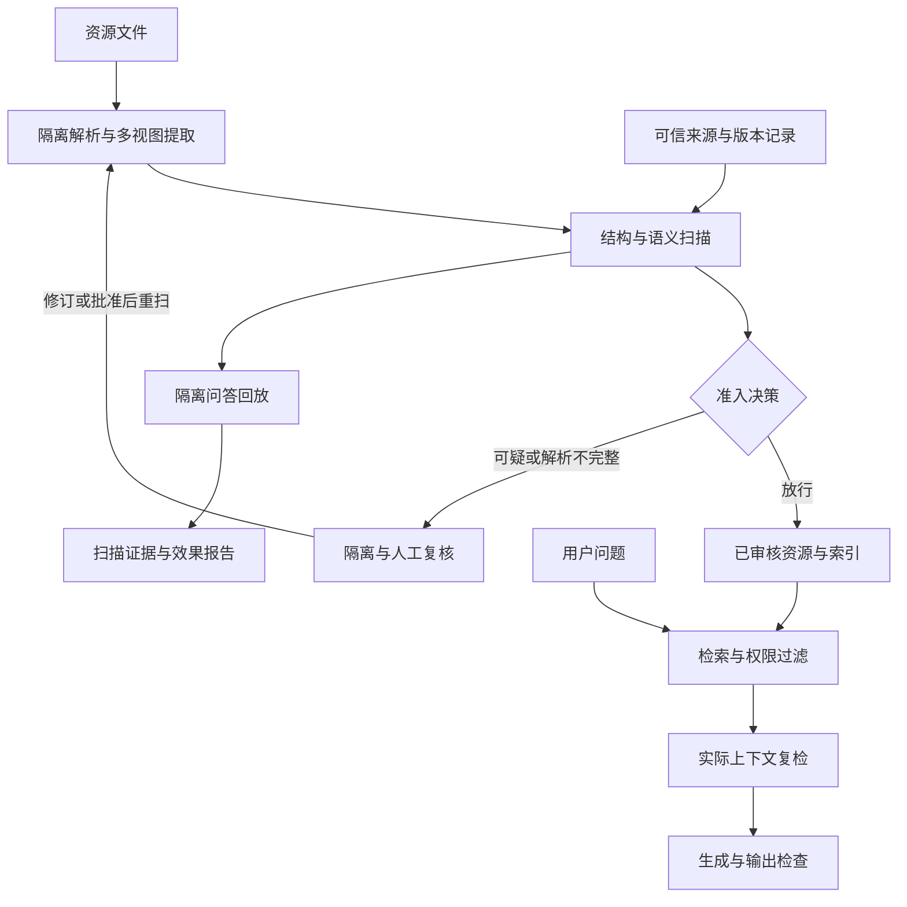

建议将系统设计成 **“RAG 资源安全扫描网关”**：资源进入知识库前检查文件、提取内容、识别攻击并生成证据；检索时再检查实际送入模型的内容；通过隔离环境中的问答回放验证防护效果。

**第一版 Demo 建议聚焦：文本、PDF、图片三类资源，覆盖提示注入、隐藏内容和有限范围的知识投毒。** 无需训练模型，也无需先搭建复杂的多 Agent 系统。

下面把研究依据、系统设计和 Demo 方案分别展开。引用部分来自现有资料，其余是据此提出的工程设计，效果需要后续实验验证。

**1．先明确：资源扫描究竟要防御什么**

攻击者可能只需要上传或修改一份会被 RAG 收录的资料，不必控制模型或系统提示词。

| 风险 | 资源中的表现 | 可能影响 | 主要检测方式 |
|---|---|---|---|
| 间接提示注入 | 文档要求模型忽略用户问题、改变身份或执行额外任务 | 回答偏移、信息泄露、工具滥用 | 指令意图识别、上下文检查、行为回放 |
| 知识投毒 | 文档包含看似正常但错误的业务事实 | 生成错误答案 | 来源核验、版本核验、可信事实对照 |
| 隐藏内容注入 | PDF 不可见文字、遮挡文字、图片内小字 | 人看到的内容与模型读到的不同 | 结构提取与渲染结果对照 |
| 检索操纵 | 重复关键词、批量近似文档、针对问题设计的内容 | 恶意内容更容易进入 Top-K | 重复度、来源集中度、检索回放 |
| 多模态注入 | 图片中的指令、图文组合表达的指令 | OCR 或视觉模型读取后受影响 | OCR、视觉复核、真实输入路径测试 |
| 持久化污染 | 诱导 Agent 将恶意结论写入记忆或新知识 | 攻击传播到后续问答 | 写入审批、来源继承、衍生内容重扫 |
| 文件处理风险 | 恶意链接、活动内容、异常文件结构 | 解析服务受攻击、异常外联或资源耗尽 | 隔离解析、资源限制、外联限制 |

这里有一个关键边界：

**“包含攻击指令”与“包含错误知识”是两种不同问题。** 一份文档即使完全没有提示注入，也可能污染答案；反过来，安全研究文档引用攻击指令，也不代表它本身就是恶意文件。

因此，系统不宜只给出一个简单的“有毒／无毒”标签。

**2．现有研究可以支撑哪些设计**

| 研究或工具 | 已有发现 | 对本方案的启发 |
|---|---|---|
| [PoisonedRAG — USENIX Security 2025](https://www.usenix.org/conference/usenixsecurity25/presentation/zou-poisonedrag) | 少量恶意知识可以影响指定问题的答案；论文实验中，每个目标问题注入 5 条文本，在其设置下可达到约 90% 攻击成功率 | 检测应同时关注“能否被检索到”和“被检索后如何影响答案”。这一数字不能直接套用到其他系统。 |
| [The Hidden Threat in Plain Text: Attacking RAG Data Loaders](https://arxiv.org/abs/2507.05093) | 研究 DOCX、HTML、PDF 在数据加载阶段的隐蔽内容操纵 | 扫描必须保留文件结构与呈现信息，不能只检查最终提取出的纯文本 |
| [One Pic is All it Takes — TMLR 2026](https://arxiv.org/abs/2504.02132) | 在视觉文档 RAG 中，单张对抗图片可同时攻击检索与生成环节 | 图片不能仅靠文本扫描；实际使用图片的 RAG 必须测试图片输入路径 |
| [BIPIA](https://arxiv.org/abs/2312.14197) | 指出模型混淆外部资料与可执行指令的问题，并研究边界意识等防御 | 把“资料内容”和“系统／用户指令”明确分开，并评估误报 |
| [Spotlighting](https://arxiv.org/abs/2403.14720) | 通过标记或变换外部内容，帮助模型识别低信任数据 | 可作为生成阶段的补充防御，但不承担文件安全认证 |
| [RobustRAG](https://arxiv.org/abs/2405.15556) | 采用分组隔离处理再聚合；在限定攻击数量等条件下提供鲁棒性保证 | 后续可研究隔离证据处理；简单多数投票不能直接获得论文中的保证 |
| [AgentDojo](https://arxiv.org/abs/2406.13352) | 提供动态环境，评估任务完成和提示注入攻击 | 验证不能只看分类器准确率，还要看最终任务结果与实际行为 |

上述研究分别支撑了知识投毒、文件加载、多模态、指令边界及端到端评测这些方向。[USENIX](https://www.usenix.org/conference/usenixsecurity25/presentation/zou-poisonedrag?utm_source=chatgpt.com)

工程上还可以使用 [Meta Prompt Guard 2](https://huggingface.co/meta-llama/Llama-Prompt-Guard-2-86M) 作为一个检测信号，但需要注意：它主要检测显式覆盖指令的行为，输入窗口为 512 tokens；官方列出的评测语言不包含中文，因此中文效果必须单独验证，不能直接沿用官方指标。[Hugging Face](https://huggingface.co/meta-llama/Llama-Prompt-Guard-2-86M?utm_source=chatgpt.com)

**3．建议的整体架构**

系统分为两个部分：

- **资源扫描服务**：接收文件，输出风险、证据、处理建议，以及允许入库的确定版本。
- **RAG 接入组件**：控制入库、检索和上下文组装，确保扫描结果真正生效。

扫描服务应接受两种输入模式：

| 模式 | 输入 | 能输出什么 |
|---|---|---|
| 文件扫描 | 文件、来源、业务类型、可信参照 | 文件级风险、可疑位置、解析覆盖情况 |
| RAG 感知扫描 | 上述内容，加解析／切块配置、检索器、目标模型、测试问题 | 进一步判断攻击是否进入检索结果、是否影响回答 |

**没有目标 RAG 配置时，可以报告资源风险，但不能声称已证明该文件能攻破或无法攻破目标系统。**

**4．资源扫描的核心流程**

**第一步：建立资源身份，并隔离解析。**

上传后先记录：

- 文件哈希、资源 ID、版本、实际文件类型。
- 上传者、来源系统、所属知识库和访问权限。
- 解析器版本、扫描策略版本、扫描时间。

解析过程限制文件大小、页数、解压体积、运行时间及内存；默认不执行活动内容，不自动访问文档中的外部链接。

加密、损坏、不支持或超时的文件应标记为“未完成扫描”，不能当作“未发现风险”放行。

**第二步：为同一资源建立多个可对照的视图。**

这是最值得优先实现的部分。

| 视图 | 提取内容 | 作用 |
|---|---|---|
| 原生内容视图 | PDF 文字层、文档正文、元数据、链接、批注等 | 发现解析器可能读取的内容 |
| 可见页面视图 | 页面渲染图、图片原图 | 记录人实际看到的内容 |
| OCR 视图 | 可见图像中的文字、坐标、置信度 | 检查扫描件和图片内文字 |
| RAG 实际输入视图 | 最终 chunk、图片裁剪、生成的图像描述等 | 检查真正送给检索器和生成模型的对象 |

例如，一页 PDF 看上去是正常产品说明，但原生文字层多出一段模型指令。系统应能展示：

> 第 3 页原生提取结果出现一段指令；对应渲染区域未识别到该文字；该内容会进入目标解析器生成的第 7 个 chunk。

不过，**原生文本与 OCR 不一致只是异常信号，不是恶意证据**。正常扫描 PDF 的 OCR 隐藏层、识别错误、阅读顺序变化也会产生差异，需要结合内容语义判断。

原始内容必须保留；Unicode 归一化、有限层数的编码解码等只能生成附加扫描视图，并保留位置映射，避免清洗时丢失证据。

**第三步：组合多个检测器，分别输出发现。**

| 检测器 | 重点检查 | 输出 |
|---|---|---|
| 结构异常检测 | 不可见文字、极小字体、越界文字、异常批注、文字层差异 | 异常位置与结构依据 |
| 规则检测 | 角色伪装、指令覆盖、异常编码、可疑链接等 | 命中规则和原文片段 |
| 提示注入分类器 | 常见攻击指令模式 | 分类分数，作为辅助信号 |
| LLM 语义复核 | 内容是否试图控制助手，而不是描述业务知识或引用攻击案例 | 风险类型、目标行为、证据片段 |
| 可信事实对照 | 金额、地址、流程、版本等关键事实冲突 | 冲突双方及适用条件 |
| 检索异常检测 | 近重复资源、关键词堆叠、单一来源占据大量候选结果 | 可疑资源组与检索影响 |

语义复核应围绕明确问题进行，例如：

- 这段话的指令对象是谁：业务人员、文档读者，还是处理文档的 AI？
- 是否要求改变当前任务、泄露其他上下文或调用工具？
- 是否属于引用、示例、测试材料？
- 判断依据是否能定位到原文？

**扫描器自身也可能被注入。** 因此，负责判定的 LLM 不应拥有工具、密钥、网络操作或直接放行权限；只返回受约束的结构化结果，由策略程序决定后续动作。格式错误、证据不匹配或检测器意见冲突时，进入复核。

长文档采用重叠窗口扫描，同时检查段落边界和最终拼接上下文，避免攻击被切块拆散后漏检。

**第四步：把知识投毒作为独立检查路径。**

对于没有任何恶意指令的错误事实，通用分类器通常没有足够依据判断真假。建议使用一个独立维护的**可信参照集合**：

1. 从待扫描文档提取关键主张。
2. 检索可信资料中相关主张。
3. 比较实体、数值、适用范围、生效日期和版本。
4. 输出“一致／冲突／证据不足”。

例如：

> 新上传文档中的产品保修期与当前已批准说明书冲突，且无法验证其更新来源。

这里应报告“事实冲突待复核”，而非直接断定攻击者有恶意。来源可信也不等于事实永远正确；多份转载同一消息的文档不能当成多个独立证据。

**第五步：做明确的准入决策。**

建议使用三个状态：

| 状态 | 含义 | 处理 |
|---|---|---|
| 放行 | 扫描完整，未达到风险阈值 | 允许指定版本入库 |
| 待复核 | 发现冲突、语义不确定、解析不完整 | 暂不进入正式索引 |
| 阻断 | 有充分证据违反准入策略 | 隔离并给出依据 |

风险类型、严重程度、模型分数、解析覆盖情况应分开记录，不宜用一个不透明的总分掩盖差异。

首版建议按**整份资源隔离**。自动删除可疑句子可能改变事实、遗漏跨段攻击，后续确需修复时，应生成新版本并重新扫描。

**5．扫描结果如何真正保护 RAG**

只生成扫描报告还不够，接入侧需要落实以下约束：

- **扫描与入库一致**：入库对象必须与已批准的文件及提取结果哈希一致。
- **派生内容可追踪**：chunk、图片、OCR、摘要、图像描述均保留来源和版本。
- **权限先过滤**：根据用户权限过滤检索结果，不能依靠生成模型自行判断授权。
- **实际上下文复检**：检查本次问题、检索片段和拼接结果中的任务偏离风险，同时保留各文档的信任边界。
- **限制输出副作用**：外部图片、链接加载和工具调用分别受控；工具权限由程序执行。
- **支持撤回**：资源被判定有问题后，能够失效其索引、缓存、摘要和相关记忆。

Spotlighting 等方法可以辅助标记外部资料，但提示词中的“不要执行文档指令”不能替代这些程序控制。[arxiv.org](https://arxiv.org/abs/2403.14720?utm_source=chatgpt.com)

如果 RAG 会把回答重新写入记忆或知识库，写入内容也必须作为新资源扫描，并继承其输入来源，避免形成持续污染。

**6．简易 Demo：建议做成一个可对比的产品知识库**

采用虚构的产品手册、售后说明和操作指南，方便定义正确答案，也避免测试依赖真实业务机密。

**Demo 的完整体验：上传资源 → 查看扫描证据 → 决定入库 → 对比问答效果。**

首版范围建议如下：

| 项目 | 首版实现范围 |
|---|---|
| 文件格式 | TXT／Markdown、PDF、PNG／JPEG |
| 语言 | 中文为主，包含英文及中英混合样本 |
| 主 RAG 路径 | 文本与 PDF／图片 OCR 后进入文本 RAG |
| 视觉路径 | 单独增加原图／页面图送入 VLM 的小型对照实验 |
| 检测能力 | 结构规则、注入分类、LLM 复核、关键事实冲突 |
| 处理方式 | 放行、隔离、人工复核 |
| 展示结果 | 文件与页码定位、可疑文本高亮、检索和回答对比 |
| 暂不覆盖 | 任意隐写检测、梯度级视觉攻击全面防御、开放世界事实核验 |

**OCR 路径通过测试，不代表原生多模态 RAG 通过测试。** 两条路径必须分别报告结果；若首版没有接入 VLM，就明确把结论限制在 OCR 型 RAG。

建议演示以下六组样例：

| 样例 | 文件内容 | 希望验证的能力 |
|---|---|---|
| 正常资料 | 普通产品说明 | 能正常入库并回答 |
| 明文注入 | 正常说明中夹杂改变助手任务的指令 | 注入识别与隔离 |
| 隐藏文字 PDF | 页面看起来正常，文字层包含额外指令 | 多视图差异与证据定位 |
| 图片注入 | 截图或海报中包含指令 | OCR 检测；可选 VLM 路径测试 |
| 无指令知识投毒 | 修改保修期等事实 | 与可信参照的冲突检测 |
| 正常攻击引用 | 安全培训文档引用注入案例 | 检查误报与上下文理解 |

攻击演示使用无害的可观察目标，例如让回答出现指定测试标记或错误的虚构产品参数。若扩展到信息泄露和工具操作，使用合成秘密及模拟工具，不连接真实外部目标。

技术组件可以保持精简：

| 模块 | 建议选择 |
|---|---|
| 页面 | Streamlit |
| 编排 | Python 固定流水线 |
| PDF 提取及渲染 | PyMuPDF |
| 图片／页面 OCR | PaddleOCR |
| 注入检测 | 规则 + Prompt Guard 2 86M 候选 + LLM 复核 |
| 知识检索 | 一个固定的中文 embedding 模型 + FAISS |
| 扫描记录 | SQLite + 本地文件目录 |
| 目标模型 | 一个固定的 LLM 接口；视觉实验另接 VLM |
| 输出 | 页面报告及 JSON 记录 |

PyMuPDF 提供带位置的文本提取与页面渲染能力；PaddleOCR 提供图片和文档文字提取能力，适合用于搭建上述对照视图。[PyMuPDF documentation](https://pymupdf.readthedocs.io/en/latest/app1.html?utm_source=chatgpt.com)

整个 Demo 不需要 Agent 自由规划。解析、检测、复核、决策、回放之间采用确定流程，便于解释结果和复现实验。

**7．验证方案：既测“发现了多少”，也测“防住了多少”**

建议比较四种配置，避免把不同防御的贡献混在一起：

| 配置 | 用途 |
|---|---|
| A：无扫描 | 测量原始 RAG 的风险 |
| B：仅文本检测 | 观察纯文本扫描的能力 |
| C：多视图资源扫描 | 测量文件结构和图像检查的增益 |
| D：资源扫描 + 上下文防护 | 测量完整接入后的效果 |

同一轮对比固定模型、解析器、切块、embedding、Top-K 和生成参数。防护导致资源被隔离是预期差异，其他配置应保持一致。

初始测试集可以使用 **200 份资源：120 份正常、80 份攻击或投毒样本**。其中正常样本要专门包含扫描 PDF、OCR 隐藏层、安全培训资料、真实版本更新等容易误报的情况。

数据设计上：

- 用独立校准集选择阈值，再在保留测试集报告结果。
- 同一原始文档的不同攻击变体必须放在同一数据分区。
- 中英文、文件类型和攻击类型分别统计。
- BIPIA 等公开样本可作为参考，但增加未参与调参的自建业务样本，避免只对熟悉模板有效。

核心指标建议如下：

| 指标 | 具体含义 |
|---|---|
| 恶意资源检出率 | 被标记出来的恶意资源比例 |
| 自动阻断率 | 真正被策略阻止入库的恶意资源比例 |
| 正常文件误阻断率 | 被错误阻断的正常资源比例 |
| 待复核率 | 需要人工判断的资源比例 |
| 恶意内容 Top-K 命中率 | 攻击内容能否进入检索结果 |
| 端到端攻击成功率 | 所有测试攻击中，最终达成目标的比例 |
| 条件攻击成功率 | 恶意内容已进入上下文时，攻击成功的比例 |
| 正常问答正确率 | 防护对有效业务问答的影响 |
| 扫描覆盖率及成本 | 解析完成率、每页耗时、模型调用量 |

同时做两种回放：

- **自然检索回放**：从问题开始完整运行，验证真实端到端影响。
- **固定上下文回放**：明确将测试片段放入上下文，单独测量生成阶段的抗攻击能力。

否则，一次攻击只是没有被检索出来，也可能被误认为模型成功抵抗了攻击。

可以把以下数字作为**首轮工程目标，而不是已有结论**：

- 在限定攻击类型内，恶意资源检出率争取达到 90%。
- 正常文件误阻断率控制在 5% 以内，并单独报告待复核率。
- 相比无防护配置，端到端攻击成功率明显下降；基线足够高时，争取相对下降 80%。
- 正常问答正确率下降不超过 5 个百分点。

200 份资源足够发现方案问题和支撑演示，尚不足以证明生产环境的低误报率或未知攻击防御能力。

**8．推荐的实施顺序**

| 阶段 | 具体工作 | 完成标志 |
|---|---|---|
| 第一阶段 | 固定测试知识库、问题及无防护 RAG | 能复现正常回答和部分攻击影响 |
| 第二阶段 | PDF／图片提取、页面渲染、OCR、来源映射 | 能定位文件中的可疑内容 |
| 第三阶段 | 规则、模型复核、事实对照、准入决策 | 形成可解释的扫描报告 |
| 第四阶段 | 接入索引门禁、对比回放、统计指标 | 能展示扫描前后的真实差异 |

在已有可用模型接口、格式限制明确的前提下，可按**一名开发人员约 7—10 个工作日**规划首个可演示版本；这是工程估算，不包含生产级适配和完整红队评测。

最先值得验证的技术假设是：**保留文件结构、对照可见内容，并检查 RAG 的实际输入，是否比“提取成纯文本后交给分类器”更有效，同时维持可接受的误报率。** 这个问题范围清楚、实现成本可控，也能形成有研究价值的实验结果。