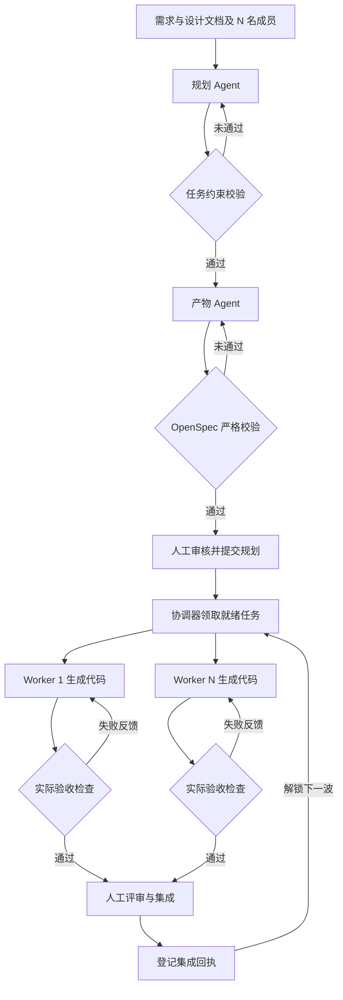

# TeamFlow Agent 实现报告

基于 OpenSpec 的指定人数团队 AI 并行开发

**版本：** 0.2.0  
**验证日期：** 2026 年 10 月 15 日  
**Markdown 整理日期：** 2026 年 10 月 16 日

> 本报告记录已交付实现及 2026 年 10 月 15 日的验证结果。自动化测试使用确定性 HTTP 模型替身，尚未完成真实本地模型和真实团队提效试点。

**目录**

- [1 Agent 场景介绍](#1-agent-场景介绍)
- [2 Agent Workflow 设计](#2-agent-workflow-设计)
- [3 Agent 功能介绍和使用说明](#3-agent-功能介绍和使用说明)
- [4 Agent 代码开源信息](#4-agent-代码开源信息)

## 1 Agent 场景介绍

### 1.1 背景与痛点

团队已有需求文档和由 AI 辅助形成的大型工程设计，但从“整体设计”到“多人可并行开发的工作包”仍需大量人工判断。直接把文档分别交给多个编码助手，容易出现职责重叠、接口理解不一致、依赖未就绪和最终无法集成的问题。

| 典型痛点 | 对开发过程的影响 | 本方案的处理方式 |
|---|---|---|
| 设计篇幅大、缺少任务边界 | 成员反复理解全局，遗漏需求 | 按权威需求与验收 ID 生成工作包 |
| 人数与技能约束未参与拆分 | 有人过载，有人等待 | 根据 N 名成员技能和任务依赖安排负责人 |
| 公共接口与共享文件冲突 | 并行改动互相覆盖 | 先定义契约，声明路径与共享资源 |
| AI 产出难以确认完成度 | 文档完整被误认为交付完成 | 分开记录规划就绪、测试通过和集成确认 |
| 缺少真实过程数据 | 无法判断是否提效 | 保留 HTTP、校验、测试与领取事件 |

### 1.2 场景定义与边界

目标用户是技术负责人、模块开发者和集成负责人。输入为设计文本、权威需求清单、N 名成员及技能，以及负责人配置的验收命令；输出为任务图、人员安排、原生 OpenSpec 变更包、受控工作区中的代码修改和可追溯执行记录。

当前实现面向单个业务域、单主机中央协调、受信团队协作。Python CLI 负责调度，本地或内网 OpenAI 兼容服务负责生成。单次规划最多 100 个任务，每个任务估时不超过 16 小时；大工程应按业务域分批输入。系统不承诺从任意整仓设计中自动恢复全部业务语义，也不自动审批、发布或替代负责人承担交付责任。

### 1.3 角色分工

| 角色 | 工作内容 | 实现方式 |
|---|---|---|
| 规划 Agent | 理解输入，生成任务、依赖与估时 | LLM JSON 输出与校验反馈循环 |
| 产物 Agent | 生成规格、设计、契约和任务清单 | LLM 输出与原生 OpenSpec 校验 |
| 协调器 | 校验约束、排期、领取和创建工作区 | 确定性程序与 SQLite 事务 |
| 开发 Worker | 在范围内改代码，根据测试错误修正 | 每个任务一个 LLM 编辑测试循环 |
| 人类负责人 | 审核语义、批准测试、评审与集成 | 保留审批、合并和集成回执 |

### 1.4 落地场景示例

以 4 人团队开发工单功能为例：D1 具备契约、测试和集成技能，D2 负责后端，D3 负责前端，D4 具备后端与测试技能。规划先形成共享契约，再并行实现 API、页面、审计和测试设施，最后统一接线与回归。

| 工作包 | 建议负责人 | 前置依赖 | 示例估时 |
|---|---|---|---|
| foundation-contracts 共享契约 | D1 | 无 | 3 小时 |
| ticket-api 创建接口 | D2 | 共享契约 | 8 小时 |
| ticket-ui 创建页面 | D3 | 共享契约 | 6 小时 |
| audit-events 审计事件 | D4 | 共享契约 | 4 小时 |
| test-harness 测试设施 | D1 | 共享契约 | 4 小时 |
| integrate-ticketing 集成回归 | D1 | 上述四个并行包 | 5 小时 |

示例调度给出 30 人时和 16 小时预计完工时间。这些数值来自任务估时及依赖计算，属于计划数据，不能用来证明实际工期缩短。运行时并行度取决于依赖、技能和资源；N 是人数上限，不要求任意时刻凑满 N 个任务。

### 1.5 预期价值与可量化目标

预期价值是降低人工拆分与交接成本，使成员围绕统一规格并行开发，并把失败和修正过程纳入证据。验证分为软件机制验收和真实团队试点两个层次。

| 验证层次 | 预先定义的目标 | 当前状态 |
|---|---|---|
| 自动化机制 | 全部测试通过；6 个变更通过原生校验 | 已完成，详见 3.7 |
| 反馈闭环 | 错误计划、产物、代码各在 3 轮内修正 | 演示中均为 2 轮 |
| 协作与范围控制 | 同任务并发领取仅 1 个成功；拒绝越界修改 | 已完成对应测试 |
| 团队效率 | 规划耗时下降 ≥50%；交付周期下降 ≥20% | 待真实团队试点 |
| 交付质量与成本 | 验收 100%；7 天严重新增缺陷 0；成本比 ≤1.2 | 待真实团队试点 |

本次交付实现了可运行 Agent 和真实自动化执行记录，但没有获得用户本地模型地址、模型权限或真实团队使用数据。因此不能声称团队提效指标已经达到。报告保留这一区分，避免把模拟响应、预计工期或服务自报 token 当作真实业务收益。

## 2 Agent Workflow 设计

### 2.1 工作流与状态流转

系统采用“LLM 生成、程序执行约束、真实工具反馈”的工作流。规划与文档校验失败时，将错误送回对应 Agent；开发阶段将真实测试退出码和输出送回 Worker。超过轮次或预算后停止，保留现场供负责人处理。



规划和开发成功均进入 `READY_FOR_REVIEW`。只有负责人审核、合并实现并登记集成回执后，协调器才把任务记为 integrated 并解锁下游。图中 Worker 1 至 Worker N 表示并发上限，实际只启动依赖已满足的工作包。

### 2.2 OpenSpec 产物与编排关系

方案使用 OpenSpec 的自定义 schema 能力，定义 `team-parallel` 六类产物。OpenSpec 管理变更文档及原生校验；团队人数、排期、领取锁和 Worker 调用由 TeamFlow 实现，不把这些能力归为 OpenSpec 内置功能。资料见第 4 部分。

| 产物 | 内容 | 依赖关系 |
|---|---|---|
| proposal.md | 变更目的、范围、能力及影响 | 无 |
| specs/*/spec.md | 规范要求与可观察验收场景 | proposal |
| design.md | 技术决策、来源与风险 | proposal |
| contracts.md | 生产者、消费者、版本、错误与兼容约定 | specs 与 design |
| tasks.md | 带验收方法的未勾选任务清单 | contracts |
| handoff.json | 机器可读的依赖、路径、技能、验收 ID | tasks |

handoff 由程序根据已校验计划生成，减少模型重复生成元数据造成的漂移。只有明确标记 `tooling_only` 的任务允许 `skip_specs`；新业务能力必须有规格。原生严格校验可发现结构问题，不能证明契约语义完全一致，仍需负责人审核。

### 2.3 调度与执行约束

规划检查需求和验收覆盖、唯一 ID、有效估时、技能可匹配性及依赖无环。排期按关键路径优先，再选择可用且合适的成员；同一人员、重叠写路径和共享资源不能在估计时间内并行。这是可解释的启发式，不保证数学最优。

运行时通过 SQLite `BEGIN IMMEDIATE` 原子领取，检查依赖是否已集成、成员容量和路径冲突。规划指纹绑定当前快照；活动期间改动设计会阻止继续领取或交接。Git worktree 隔离各任务的变更；同一任务另有 Worker 文件锁，防止重复执行。

### 2.4 模型调用与失败处理

每次使用 system/user 消息请求非流式 JSON，不依赖 function calling。计划和产物默认最多 3 轮语义修正，开发默认最多 3 轮编辑测试；HTTP 暂时错误的重试另行计数。输出截断、最终连接失败等错误需要调整配置并重启新运行。

每个运行或 Worker 默认最多 80 次 HTTP 请求。token 上限依据服务返回的 usage，在下一请求前检查；服务不提供 usage 时不能硬性保证 token 或费用上限。batch 的预算是各 Worker 预算之和。所有阶段保存事件、最终响应与校验或测试结果；不生成虚假的 CI 成功记录。

## 3 Agent 功能介绍和使用说明

### 3.1 已实现功能

| 命令 | 功能与结果 |
|---|---|
| doctor | 检查本地模型列表接口和 JSON 聊天响应 |
| plan | 生成并修正规划、排期及 OpenSpec 产物 |
| install | 按审核后的 bundle 哈希安装，先检查文件冲突 |
| batch | 按成员安排并发执行一波已就绪任务 |
| claim / workspace / packet | 单任务领取、创建 worktree、获取上下文 |
| develop | 限定范围改代码，运行实际检查并反馈修正 |
| record-integrated / status / release | 登记集成、查看状态、释放已停止的任务 |
| demo | 运行显式标记的确定性 HTTP 演示 |

### 3.2 安装与最小可运行演示

环境要求为 Python 3.10+、Node.js 20.19+ 和 Git。本次实测 Linux、Python 3.12.14、Node.js 24.19.0；Windows 和 macOS 尚未实测。Python 运行时仅依赖标准库，OpenSpec CLI 通过 package-lock.json 锁定为 1.13.1。

在源码根目录执行以下命令。Windows PowerShell 的虚拟环境激活命令改为 .\.venv\Scripts\Activate.ps1；命令续行语法也需按终端调整，或写成一行。

```bash
python -m venv .venv
source .venv/bin/activate
python -m pip install .
npm ci --ignore-scripts --no-audit --no-fund
teamflow --version
teamflow demo --out ../runs/demo-001
```

源码也可直接用 python -m teamflow_agent 执行。dist 目录包含 wheel，本次已在新建虚拟环境中离线安装，并从源码目录之外成功运行完整演示。

演示内部启动回环地址 HTTP 测试服务，故意返回错误计划、空契约和错误代码，验证系统能收到真实反馈并修正。它不是本地模型推理，输出不会计入真实模型或团队效果。结果位于 demo-result.json，事件和测试输出位于 planning/trace 与 development/checks。

所有 --out 应使用新目录，已有结果不会被静默覆盖。本版本不支持断点续跑；失败改动保留，重启前先检查已有工作区。

### 3.3 接入本地 OpenAI 兼容服务

复制 config/llm.local.example.json 为 config/llm.local.json，修改 `base_url` 和 model。API 根地址通常以 /v1 结尾；本工具追加 /chat/completions。model 使用服务实际暴露的 ID，不假定某个模型已安装。

```json
{
  "base_url": "http://127.0.0.1:8000/v1",
  "model": "YOUR_SERVED_MODEL_NAME",
  "api_key_env": "TEAMFLOW_API_KEY",
  "timeout_seconds": 120,
  "http_retries": 2,
  "max_tokens": 8192,
  "temperature": 0.1,
  "json_mode": false,
  "max_http_calls": 80,
  "max_reported_tokens": 200000,
  "extra_body": {}
}
```

需要鉴权时，将密钥设置到 `TEAMFLOW_API_KEY` 环境变量；无鉴权服务可把 `api_key_env` 设为空字符串。密钥不写入配置文件，日志会对已配置的密钥值做脱敏。没有云端回退。Ollama 本地地址常见为 http://127.0.0.1:11434/v1；vLLM 端口和模型名称以部署配置为准。

```bash
teamflow doctor --llm config/llm.local.json \
  --out ../runs/doctor-001
```

只有 chat_ok 为 true 才代表这次配置通过最小 JSON 检查。doctor 不证明复杂规划质量。`json_mode` 仅在服务支持 `response_format` 时开启；不接受 temperature 的模型设为 null。服务扩展字段可放在 `extra_body`，兼容性取决于具体服务与模板。只支持非流式 `Chat Completions`，不调用 Responses API。

### 3.4 准备输入并生成计划

examples/ticketing 提供设计、需求和成员示例。members.json 数组中的成员数量就是指定人数 N；每人必须有唯一 ID 和技能。requirements.json 中每个需求都有 ID、source 与 `acceptance_tests`；这些内容是覆盖校验依据，需由负责人确认。

```bash
teamflow plan --llm config/llm.local.json \
  --design examples/ticketing/source-design.md \
  --requirements examples/ticketing/requirements.json \
  --team examples/ticketing/members.json \
  --out ../runs/plan-001
```

设计可为单文件或文本目录。默认按关键词选取最多 60000 字符的带行号片段；`context_truncated` 表示存在未输入内容。当前既有接口及主规格应由负责人纳入设计输入，本版不自动遍历整个代码仓库。查看 result.json 和 project 目录，审核任务边界与接口一致性后再安装。

### 3.5 安装规划并启动并行开发

从 plan-001/result.json 复制审核后的 `bundle_sha256`，将其替换命令中的 `YOUR_BUNDLE_SHA256`，作为 --approve 参数。安装遇到不同内容的同名文件时拒绝复制；已有项目配置和忽略规则保留。

```bash
teamflow install --bundle ../runs/plan-001 \
  --project ../my-project --approve YOUR_BUNDLE_SHA256
```

目标项目需为 Git 仓库。确认 .gitignore 包含 .teamflow/，由负责人审核并提交规划快照。创建 worktree 要求中央工作区干净。不要把运行日志或工作树放进中央仓库。

为每个准备执行的任务创建外部检查配置，例如 ../checks/foundation-contracts.json。测试程序、依赖及验收语义需由负责人事先确认；下例中的 pytest 是项目测试依赖，需要另行安装。

```json
{
  "checks": [
    {
      "id": "AC01",
      "argv": ["python", "-m", "pytest", "tests/test_contract.py"],
      "timeout_seconds": 60
    }
  ]
}
```

检查 ID 必须覆盖该任务的 `acceptance_tests`。配置应位于 worktree 外部；可信验收程序也应避免落入模型可写范围。命令用 argv 数组执行，`shell=False`，模型无权生成任意待执行命令。

```bash
teamflow batch --llm config/llm.local.json \
  --project ../my-project --checks-dir ../checks \
  --worktrees ../worktrees --out ../runs/wave-001 \
  --execute-checks
```

batch 选择已就绪的任务并创建独立工作区，每名成员最多一个活动 Worker，总并发不超过 N。没有检查配置、依赖未满足或资源冲突的任务会跳过并列出原因。公共契约未集成时，首波可能只有一个任务。

每个 Worker 输出 `READY_FOR_REVIEW` 或 `BLOCKED`。审核成功任务、完成真实集成并登记回执后，使用新输出目录启动下一波。batch 不自行批准合并，也不在后台无限轮询。多人可在同一协调主机分别运行单任务命令；跨机器分布式协调和身份鉴权未包含在当前版本中。

### 3.6 单任务开发与集成确认

需要人工指定成员时，先 claim，保存结果中的 token 与 `plan_sha256`，再创建工作树。以下示例中占位符须替换为实际领取结果。

```bash
teamflow claim --project ../my-project \
  --change foundation-contracts --member D1
teamflow workspace --project ../my-project \
  --change foundation-contracts --token YOUR_TOKEN \
  --destination ../worktrees/foundation
teamflow develop --llm config/llm.local.json \
  --project ../my-project --change foundation-contracts \
  --token YOUR_TOKEN --checks ../checks/foundation-contracts.json \
  --out ../runs/dev-001 --execute-checks
```

Worker 只接受约定路径内的完整文本文件修改，每轮最多 30 个文件、单文件 200 KB、总量 1 MB。越界路径、符号链接、隐藏文件及 OpenSpec/teamflow/CI 元数据等受保护路径会被拒绝。当前不支持二进制文件和删除操作。测试失败会回传输出；达到轮次上限后保留改动与日志。

测试通过只意味着已配置检查通过。负责人还需审查差异、确认契约一致性和测试充分性，提交实现并运行 CI，再合并到中央仓库。不得仅凭模型说明登记完成。

集成回执示例：

```json
{
  "change_id": "foundation-contracts",
  "plan_sha256": "领取结果中的plan_sha256",
  "commit": "已合并实现的完整提交哈希",
  "ci_run_url": "https://你的CI/真实运行地址",
  "reviewer": "D2",
  "passed": true,
  "passed_acceptance_ids": ["AC01"]
}
```

```bash
teamflow record-integrated --project ../my-project \
  --change foundation-contracts --token YOUR_TOKEN \
  --receipt ../receipts/foundation-contracts.json
teamflow status --project ../my-project
```

`bundle_sha256` 用于安装包审核，`plan_sha256` 绑定安装后的规划快照，两者不可互换。回执检查覆盖提交祖先关系、独立 reviewer、验收 ID 和快照匹配；CI URL 与通过结论仍是操作员声明，当前不验证 CI 服务身份。Git worktree 也不是 OS 沙箱，生产执行生成代码应采用容器或受限账号。

### 3.7 本次真实运行记录与目标验收

G01–G06 在首次演示与测试执行前写入 evidence/protocol.json；test-results.json 保存协议 SHA-256、时间和各用例结果。本次记录来自实际 HTTP、OpenSpec CLI、Git、SQLite 与测试进程执行，模型回复由确定性测试服务提供。

| 验收目标 | 实测结果 | 结论与证据 |
|---|---|---|
| G01 全部机制测试通过 | 32 项通过，0 失败、0 错误、0 跳过 | 达成；test-results.json |
| G02 原生规格校验 | 6/6 个变更通过 OpenSpec 1.13.1 严格校验 | 达成；planning-trace |
| G03 规划与产物反馈 | 计划 2 轮；注入错误的产物 2 轮 | 达成，均在 3 轮以内 |
| G04 代码测试反馈 | 第一轮真实检查失败，第二轮通过 | 达成；development/checks |
| G05 原子领取 | 4 个线程同时领取，同一任务仅 1 个成功 | 达成；对应测试用例 |
| G06 范围与脱敏 | 越界和符号链接拒绝；测试密钥未进入日志 | 达成；对应测试用例 |
| 补充并发验证 | 两个 Worker 的 HTTP 调用在同步屏障处会合 | 证明两个 Worker 实际并发执行 |
| 安装验证 | 新虚拟环境离线安装 wheel，目录外运行演示成功 | install-result.json |

32 项测试耗时 12.312 秒。独立 wheel 演示耗时 4.718 秒，共观察到 13 次 HTTP 请求：1 次模型列表读取、12 次 `Chat Completions` 请求。请求包括 doctor、规划与产物反馈、两轮代码生成。以上是本环境机制执行耗时，不是实际模型速度或真实开发工期。

演示最终运行了 5 条契约示例断言，只覆盖一个小型代码示例；其余五个业务包和完整工单验收尚未实现。真实模型推理调用为 0，真实团队试点人数为 0，故没有可报告的真实模型成功率、账单或团队效率提升。

### 3.8 真实使用数据的采集方案

建议选 8 个相似业务包组成 4 对比较。基线为 OpenSpec、人工拆分和同一编码模型；实验组增加 TeamFlow。固定人员、模型、验收范围，记录需求冻结、计划审批、领取、检查、合并时间，以及人工投入、用量、缺陷和阻塞原因。

规划耗时按需求就绪至计划批准计算；交付周期按需求就绪至最后一个验收提交集成计算；成本同时计入人工与模型费用。对每一对计算实验/基线比值，再报告中位数及全部样本；失败任务也纳入。目标为 1.5 节列出的效率、质量和成本门槛，未满足时如实报告。

源码保留 pilot_protocol.json 与 field_event.schema.json，可用于登记后续试点。接入真实模型并完成实际试点后，才能补充“真实使用场景已达标”的结论。

## 4 Agent 代码开源信息

### 4.1 发布信息与许可

| 项目 | 信息 |
|---|---|
| 项目名称 | TeamFlow Agent |
| Python 包名 | teamflow-openspec-agent |
| 版本 | 0.2.0 |
| 交付形式 | 完整源码 ZIP、可安装 wheel、README、样例与验证证据 |
| 本项目许可 | MIT；包含 LICENSE |
| 主要外部工具 | OpenSpec 1.13.1、Git；Python 运行时仅标准库 |
| 公开仓库地址 | 尚未建立；不填写虚构链接 |
| 模型权重 | 不包含；接入用户已有 OpenAI 兼容服务 |

本次按 MIT 许可交付可复用源码，公开仓库托管尚未完成。维护者可以将解压后的项目推送到自己的 GitHub、GitLab 或 Gitee 仓库，复核后发布 v0.2.0 标签；报告中的仓库地址应在真实发布后补填。

### 4.2 核心代码与复现材料

| 文件或目录 | 作用 |
|---|---|
| teamflow_agent/llm.py | HTTP 接入、超时重试、用量与配置 |
| context.py / workflow.py | 设计索引、规划和产物校验反馈 |
| planning.py / coordinator.py | 约束、调度、领取、worktree 与回执 |
| developer.py / batch.py | 限定范围编辑、真实检查和并发执行 |
| openspec.py / assets/ | 原生 CLI 适配、自定义 schema 与演示数据 |
| tests/ / scripts/verify.py | 32 项可复现机制测试与结果记录 |
| config/ / examples/ | 本地模型配置、工单输入、团队试点协议 |
| evidence/ / dist/ | 实际结果、日志、规划快照与 wheel |

项目提供 THIRD_PARTY_NOTICES.md 和 OpenSpec MIT 许可副本。node_modules、虚拟环境、模型权重和真实凭据不进入交付包；npm 间接依赖在安装时由各自许可证约束。发布前应替换示例成员、清理业务输入和审查运行日志中的业务内容。

### 4.3 参考资料与后续边界

[OpenSpec 项目](https://github.com/Fission-AI/OpenSpec)；[OpenSpec 自定义 schema 文档](https://github.com/Fission-AI/OpenSpec/blob/main/docs/customization.md)；[Ollama OpenAI compatibility](https://docs.ollama.com/api/openai-compatibility)；[vLLM OpenAI-Compatible Server](https://docs.vllm.ai/en/latest/serving/online_serving/openai_compatible_server/)。文档查阅日期为 2026 年 10 月 15 日；本项目原生校验固定使用 OpenSpec 1.13.1。

当前适合受信环境中的单主机试点。生产扩展重点为中央授权服务、可验证 CI 回执、容器执行、持久化任务队列和真实模型质量基线；这些能力未列为本次已经实现的功能。
